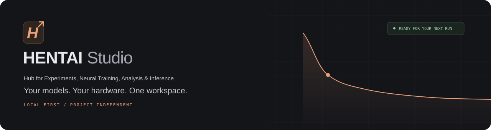
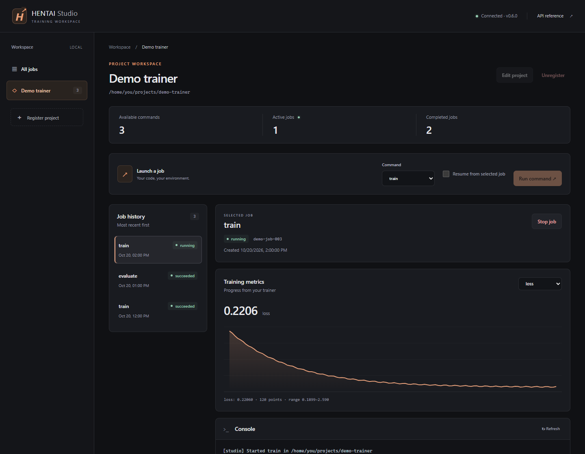
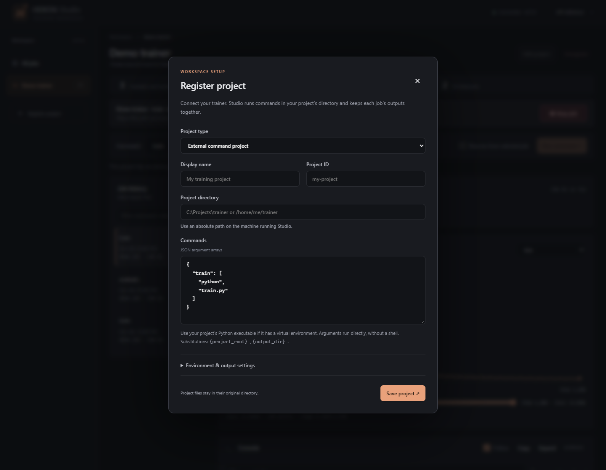

<p align="center">
  
</p>

<p align="center">
  <strong>A standalone training manager with a native Windows app.</strong><br>
  Manage your own trainers locally or on a cloud backend. Inspect runs, test saved models, and monitor hardware.
</p>

<p align="center">
  <a href="https://github.com/Lithium357/HENTAI-Studio/actions/workflows/tests.yml"></a>
  <a href="CHANGELOG.md"></a>
  
  
  
</p>

<p align="center">
  <a href="#get-started">Get started</a> &nbsp;·&nbsp;
  <a href="#the-workspace">Workspace</a> &nbsp;·&nbsp;
  <a href="docs/API.md">API &amp; Python client</a> &nbsp;·&nbsp;
  <a href="docs/WINDOWS.md">Desktop app</a> &nbsp;·&nbsp;
  <a href="CHANGELOG.md">What's new</a> &nbsp;·&nbsp;
  <a href="CONTRIBUTING.md">Contributing</a>
</p>

<details>
<summary>Optional browser dashboard screenshots</summary>

<p align="center">
  
  <sub>Illustrative browser workspace. The dedicated Windows app uses native Windows controls; these screenshots show the optional browser interface.</sub>
</p>

<p align="center"></p>

[Console workspace](docs/assets/console.png) · [Output files](docs/assets/files.png) · [Resume and command preview](docs/assets/launch-resume.png) · [Compact desktop](docs/assets/desktop-compact.png).

</details>

## Your trainer, with a place to work

Studio manages external processes, so your projects keep their own code, dependencies, and environments. Register a directory and a few named commands; Studio handles job history, console output, metric charts, and artifact downloads. No model framework or project plugin is required.

| Connect | Run | Observe |
| :--- | :--- | :--- |
| Register any local project directory. | Launch named commands in the project’s own environment. | Follow console output and any numeric metric. |
| Keep separate commands for training, evaluation, or resume. | Run independent projects concurrently, with one active job per project. | Download checkpoints and files from each job’s output directory. |

The default installation needs no training libraries. Optional [scratch LLM support](docs/LLM.md) adds a local trainer and checkpoint chat tester.

Studio is independent of the HENTAI diffusion model and Lucy. It runs your external commands and keeps each project's training environment separate from the app.

## The workspace

The Windows app is written in C#/.NET Windows Forms, with native controls and a locally drawn chart. It connects directly to the JSON API and requires no embedded browser or WebView2 Runtime. The browser dashboard remains available separately.

| View | Use it for |
| --- | --- |
| **Runs** | Start a command or resume a selected run; inspect **Metrics**, **Console**, and **Output files**. |
| **Test model** | Load the latest complete scratch-model checkpoint, choose CPU or GPU sampling, and test responses in chat. |
| **Hardware** | Read live CPU, RAM, and per-GPU measurements from the connected backend. |

Choose a project from the sidebar; **All jobs** shows the complete history. **Project settings** manages the selected project. The startup port picker and **New window…** let you connect independent windows to different backend ports. Window titles show the port and **Local / Cloud** location. Compact windows rearrange their panes for split-screen use.

### Current features

- **Latest-checkpoint loading:** discover and load saved weights with one button or API request. Opt into automatic loading when opening the tester. Incomplete saves are skipped; manual paths and generation controls remain under Advanced options.
- **CPU or GPU sampling:** CPU is the default and leaves GPU training running. Explicitly enable **Allow GPU sampling alongside training** to share GPU memory/compute with the trainer. Loaded-model status identifies the active sampling mode.
- **NVIDIA, AMD, and Intel monitoring:** separate GPU rows with utilization, memory, and available sensors. Missing readings are shown as unavailable; idle readings stay zero. Provider/platform coverage is documented in the [hardware guide](docs/HARDWARE.md).
- **Independent process lifetime:** closing a window leaves training running. Studio controls trainers through dedicated job supervisors and verified process identities.

See [the changelog](CHANGELOG.md) for changes through **0.9.1**.

## Get started

The backend needs **Python 3.11+**. The native Windows client needs the **.NET 8 Desktop Runtime**; building it needs the **.NET 8+ SDK**. Python is not required on a Windows client that connects to an existing backend.

Clone the repository and prepare the backend environment:

```sh
git clone https://github.com/Lithium357/HENTAI-Studio.git
cd HENTAI-Studio
python -m venv .venv
```

**Linux / WSL**

```sh
.venv/bin/python -m pip install .
.venv/bin/hentai-studio serve
```

<details>
<summary><strong>Windows PowerShell</strong></summary>

```powershell
.venv\Scripts\python -m pip install .
.venv\Scripts\hentai-studio serve
```

With the .NET SDK installed, build the native app from this checkout:

```powershell
./windows/HENTAIStudio/build.ps1
& '.\dist\HENTAIStudio\HENTAI Studio.exe' --pick-port 7860
```

The picker connects to an existing backend. Starting a local backend is an explicit option. The [Windows guide](docs/WINDOWS.md) covers installation with a private backend environment and Desktop/Start menu shortcuts.

</details>

Connect the native client to port **7860**, or open the optional browser dashboard at **[localhost:7860](http://127.0.0.1:7860)**. Select **Register project**, using an absolute directory and your trainer's executable. The default workspace is `~/.hentai-studio`; select another with `--workspace PATH`.

> Run Studio where your trainer runs. For Linux or ROCm projects, use Linux/WSL and Linux paths. Studio executes local commands and has no account system; keep it on a trusted local machine. It binds to loopback by default.

### Connect to AWS or another remote machine

Run the backend on the training host with `hentai-studio serve --location cloud`. Forward its loopback port over SSH:

```sh
ssh -N -L 8786:127.0.0.1:7860 user@training-host
```

Connect Studio to local port **8786**. Commands, paths, checkpoint loading, inference, and hardware readings refer to the backend machine. Each remote backend needs the corresponding Studio update: **0.8+** for hardware, **0.9+** for latest-checkpoint loading, and **0.9.1+** for shared GPU sampling.

### Try it without a model

Register this checkout as a project and add this command, replacing the first argument with your Python executable:

```json
{
  "train": ["/absolute/path/to/python", "-u", "examples/demo_train.py"]
}
```

The [demo trainer](examples/demo_train.py) produces metrics and a checkpoint using only the Python standard library. An [example project definition](examples/project.json) is included.

### Connect your real trainer

Studio executes argument arrays directly in your registered directory. It supplies `STUDIO_OUTPUT_DIR` for each new job and `STUDIO_RESUME_DIR` when resuming. Write metrics, checkpoints, and artifacts there:

```jsonl
{"step": 1, "loss": 2.1, "accuracy": 0.60}
{"step": 2, "loss": 1.8, "accuracy": 0.70}
```

Numeric JSONL or CSV columns become charts. Metrics are optional; console output works for any command. See [projects and jobs](docs/PROJECTS.md) for command substitutions, environment variables, output conventions, and process recovery.

## Train a scratch LLM and test it in chat

Choose **Scratch LLM training** when registering a project. Point Studio to your local architecture configuration, tokenizer, dataset, and training Python environment. The optional runner initializes fresh weights, records training metrics, and saves resumable checkpoints.

Open **Test model** and click **Load latest checkpoint**, or enable **Auto-load latest when opening this tester**. Discovery searches the newest run with complete weights, selecting its final model after success or the highest complete checkpoint step. The loaded path is shown, and each project's conversation stays separate.

Sampling runs in a separate inference worker. **CPU** lets GPU training continue. **GPU** can either reserve the device for testing or explicitly share it with training using the overlap option. No remote model provider is involved; all model loading and inference happen on your selected backend.

The API exposes the same flow:

```http
POST /api/projects/my-model/chat/load-latest
Content-Type: application/json

{"device":"cpu"}
```

For shared GPU sampling, use `{"device":"cuda","allow_training_overlap":true}`. `GET /api/projects/{id}/chat/checkpoints/latest` discovers the latest checkpoint without loading it. Hardware is available through `GET /api/hardware`.

See the [scratch LLM guide](docs/LLM.md) for installation, a small local example, dataset formats, and the API.

## Script the same workflow

```python
from hentai_studio import StudioClient

studio = StudioClient()
project = studio.create_project(
    "/absolute/project",
    {"train": ["/absolute/project/.venv/bin/python", "train.py"]},
)
job = studio.wait(studio.start_job(project))
print(job["state"])
print(studio.logs(job, tail=8192)["text"])
```

The included Python client uses the standard library. The [API guide](docs/API.md) covers HTTP requests, pagination, stop/resume, artifact downloads, and structured errors. Interactive API docs are available at `/api/docs` on your running instance.

## Find your way around

| Guide | What’s inside |
| :--- | :--- |
| [Dashboard](docs/DASHBOARD.md) | Projects, job controls, metrics, console, and files |
| [Projects and jobs](docs/PROJECTS.md) | Trainer integration, outputs, resume, and recovery |
| [Scratch LLMs & chat](docs/LLM.md) | Local scratch training, checkpoints, and response testing |
| [API & Python client](docs/API.md) | Request examples and the complete client workflow |
| [Command line](docs/CLI.md) | Server options and workspace configuration |
| [Windows app](docs/WINDOWS.md) | Build, installation, and backend selection |
| [Hardware monitoring](docs/HARDWARE.md) | Live backend CPU/RAM and NVIDIA, AMD, and Intel GPU support |
| [Architecture](docs/ARCHITECTURE.md) | Application boundaries and process ownership |
| [Development](docs/DEVELOPMENT.md) | Tests, browser checks, and packaging |
| [Migration](docs/MIGRATION.md) | Changes from earlier bundled versions |
| [Changelog](CHANGELOG.md) | Native desktop, monitoring, latest-checkpoint, and sampling updates |

## Development

```sh
python -m pip install -e '.[dev]'
python -m pytest
npm test
```

No ML packages or GPU are required for the default application tests. The optional LLM runtime smoke test trains a tiny offline CPU model, discovers its latest checkpoint, and generates a response. CI covers Python/JavaScript on Windows and Linux, plus native Windows control/API checks. See [Development](docs/DEVELOPMENT.md) for browser and optional ML checks, and [Contributing](CONTRIBUTING.md) before proposing a change.

---

<sub>Licensed under the [GNU General Public License v3.0](LICENSE). See [source provenance](SOURCE_PROVENANCE.md) for the project’s history and third-party notices.</sub>
