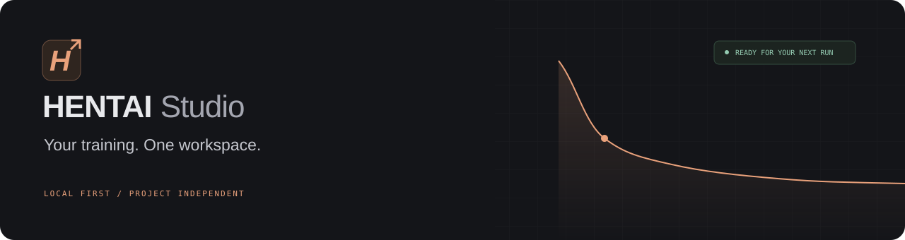
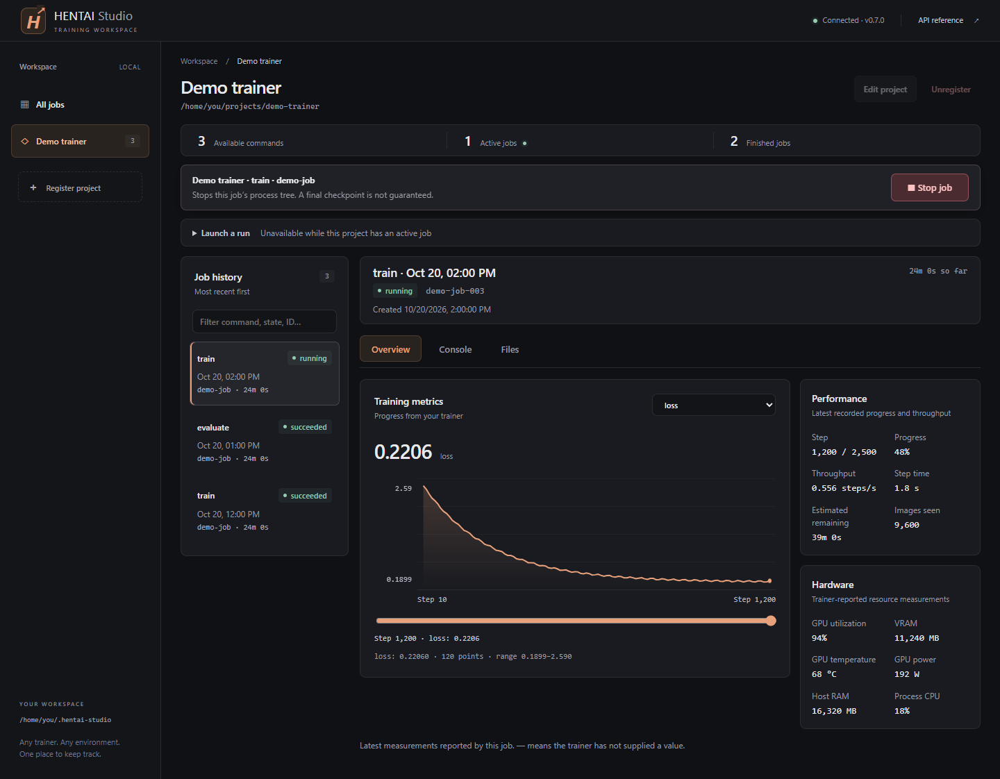
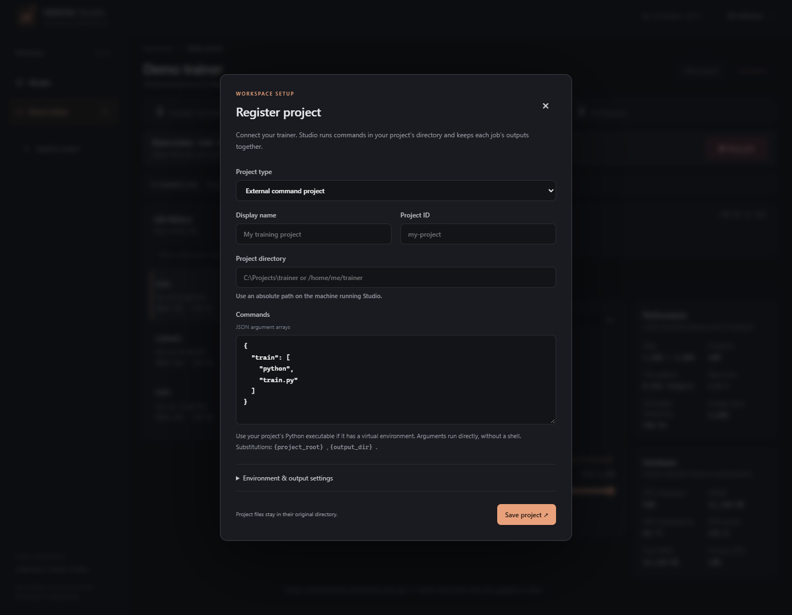

<p align="center">
  
</p>

<p align="center">
  <strong>A local control room for your training projects.</strong><br>
  Run your own commands. Follow the metrics. Keep every job’s outputs together.
</p>

<p align="center">
  <a href="https://github.com/Lithium357/HENTAI-Studio/actions/workflows/tests.yml"></a>
  
  
</p>

<p align="center">
  <a href="#get-started">Get started</a> &nbsp;·&nbsp;
  <a href="docs/DASHBOARD.md">Dashboard</a> &nbsp;·&nbsp;
  <a href="docs/API.md">API &amp; Python client</a> &nbsp;·&nbsp;
  <a href="docs/WINDOWS.md">Desktop app</a> &nbsp;·&nbsp;
  <a href="CONTRIBUTING.md">Contributing</a>
</p>

<p align="center">
  
  <sub>Illustrative demo workspace. Your trainer supplies the commands, metrics, and output files.</sub>
</p>

<details>
<summary>Project setup &amp; desktop inspection views</summary>

<p align="center"></p>

[Console workspace](docs/assets/console.png) · [Output files](docs/assets/files.png) · [Resume and command preview](docs/assets/launch-resume.png) · [Compact desktop](docs/assets/desktop-compact.png).

</details>

## Your trainer, with a place to work

Studio manages external processes, so your projects keep their own code, dependencies, and environments. Register a directory and a few named commands; Studio handles job history, console output, metric charts, and artifact downloads. No model framework or project plugin is required.

| Connect | Run | Observe |
| :--- | :--- | :--- |
| Register any local project directory. | Launch named commands in the project’s own environment. | Follow console output and any numeric metric. |
| Keep separate commands for training, evaluation, or resume. | Run independent projects concurrently, with one active job per project. | Download checkpoints and files from each job’s output directory. |

Studio runs independently of [HENTAI](https://github.com/Lithium357/HENTAI) and [Lucy](https://github.com/Lithium357/LUCY-ERP). They can be managed like any other external project. The default installation needs no training libraries. Optional [scratch LLM support](docs/LLM.md) adds a local trainer and checkpoint chat tester.

## Get started

Requires **Python 3.11+**. Clone the repository first:

```sh
git clone https://github.com/Lithium357/HENTAI-Studio.git
cd HENTAI-Studio
python -m venv .venv
```

**Linux / WSL**

```sh
.venv/bin/python -m pip install .
.venv/bin/hentai-studio serve
```

<details>
<summary><strong>Windows PowerShell</strong></summary>

```powershell
.venv\Scripts\python -m pip install .
.venv\Scripts\hentai-studio serve
```

For a native window, see the [Windows desktop app guide](docs/WINDOWS.md).

</details>

Open **[localhost:7860](http://127.0.0.1:7860)** and select **Register project**. Use an absolute directory and your trainer’s executable. The default workspace is `~/.hentai-studio`; select another with `--workspace PATH`.

> Run Studio where your trainer runs. For Linux or ROCm projects, use Linux/WSL and Linux paths. Studio executes local commands and has no account system; keep it on a trusted local machine. It binds to loopback by default.

### Try it without a model

Register this checkout as a project and add this command, replacing the first argument with your Python executable:

```json
{
  "train": ["/absolute/path/to/python", "-u", "examples/demo_train.py"]
}
```

The [demo trainer](examples/demo_train.py) produces metrics and a checkpoint using only the Python standard library. An [example project definition](examples/project.json) is included.

### Connect your real trainer

Studio executes argument arrays directly in your registered directory. It supplies `STUDIO_OUTPUT_DIR` for each new job and `STUDIO_RESUME_DIR` when resuming. Write metrics, checkpoints, and artifacts there:

```jsonl
{"step": 1, "loss": 2.1, "accuracy": 0.60}
{"step": 2, "loss": 1.8, "accuracy": 0.70}
```

Numeric JSONL or CSV columns become charts. Metrics are optional; console output works for any command. See [projects and jobs](docs/PROJECTS.md) for command substitutions, environment variables, output conventions, and process recovery.

## Train a scratch LLM and test it in chat

Choose **Scratch LLM training** when registering a project. Point Studio to your local architecture configuration, tokenizer, dataset, and training Python environment. The optional runner initializes fresh weights, records training metrics, and saves resumable checkpoints.

The **Chat tester** loads your saved local checkpoints in a separate inference worker. CPU is the default; GPU inference has explicit load/unload controls and cannot compete with an active Studio training job. No remote model API is involved.

See the [scratch LLM guide](docs/LLM.md) for installation, a small local example, dataset formats, and the API.

## Script the same workflow

```python
from hentai_studio import StudioClient

studio = StudioClient()
project = studio.create_project(
    "/absolute/project",
    {"train": ["/absolute/project/.venv/bin/python", "train.py"]},
)
job = studio.wait(studio.start_job(project))
print(job["state"])
print(studio.logs(job, tail=8192)["text"])
```

The included Python client uses the standard library. The [API guide](docs/API.md) covers HTTP requests, pagination, stop/resume, artifact downloads, and structured errors. Interactive API docs are available at `/api/docs` on your running instance.

## Find your way around

| Guide | What’s inside |
| :--- | :--- |
| [Dashboard](docs/DASHBOARD.md) | Projects, job controls, metrics, console, and files |
| [Projects and jobs](docs/PROJECTS.md) | Trainer integration, outputs, resume, and recovery |
| [Scratch LLMs & chat](docs/LLM.md) | Local scratch training, checkpoints, and response testing |
| [API & Python client](docs/API.md) | Request examples and the complete client workflow |
| [Command line](docs/CLI.md) | Server options and workspace configuration |
| [Windows app](docs/WINDOWS.md) | Build, installation, and backend selection |
| [Architecture](docs/ARCHITECTURE.md) | Application boundaries and process ownership |
| [Development](docs/DEVELOPMENT.md) | Tests, browser checks, and packaging |
| [Migration](docs/MIGRATION.md) | Changes from earlier bundled versions |

## Development

```sh
python -m pip install -e '.[dev]'
python -m pytest
npm test
```

No ML packages or GPU are required for the default application tests. The optional LLM runtime smoke test uses a tiny offline CPU model. See [Contributing](CONTRIBUTING.md) before proposing a change. Tests run on Windows and Linux with Python 3.11 and 3.12; browser acceptance is documented separately.

---

<sub>Licensed under the [GNU General Public License v3.0](LICENSE). See [source provenance](SOURCE_PROVENANCE.md) for the project’s history and third-party notices.</sub>
