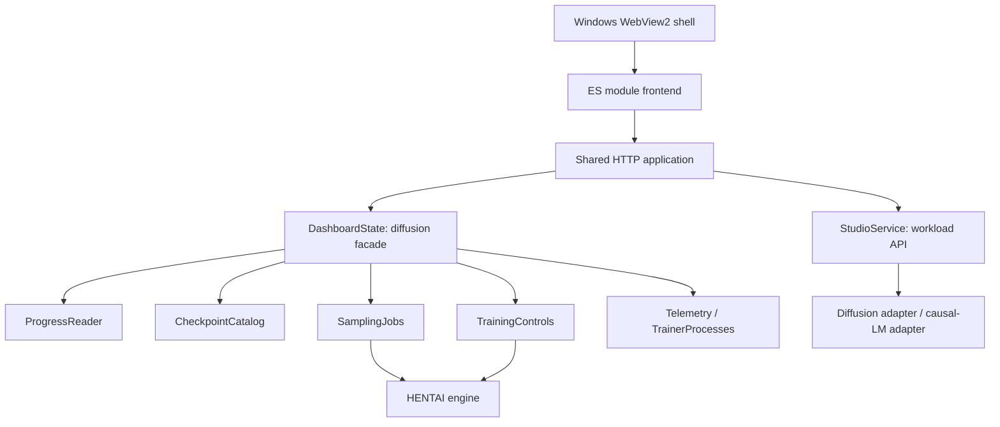

# Studio dashboard architecture

HENTAI is the diffusion engine. HENTAI Studio is the dashboard application that observes runs and requests explicit actions through the engine's installed tools and watchdog scripts.

## Python boundaries

`dashboard.py` and `studio.py` retain their public CLI entry points. `dashboard_app/state.py` composes the diffusion services and produces the existing status response. Each service owns its own state: sampling owns the subprocess and lock; telemetry owns its cache, timing, and energy accumulation. Training actions are serialized per dashboard instance.

`dashboard_app/processes.py` identifies trainers by the selected config or run directory and watchdogs by engine project and config. Stop signals only selected trainers and their worker descendants. Studio does not signal an entire shell process group. Resume passes the selected project/config to portable watchdogs; legacy fixed-path watchdogs are accepted only when their project, reference profile, and run match the selection. An incompatible script leaves training paused and returns an actionable error.

`web/application.py` contains transport-independent routing, JSON validation, downloads, and confined static/sample lookup. `web/server.py` provides bounded request reads and HTTP response encoding. Both dashboard mode and API-only mode use these same versioned routes. Invalid bodies and control errors return JSON errors. The dashboard still serves `/api/status`, `/api/action`, checkpoint catalogs, PNG samples, and CSV downloads for compatibility.

Model libraries remain lazy imports. Serving metadata, assets, progress, and run lists does not import Torch, Transformers, Diffusers, or PEFT.

## Browser boundaries

The browser loads standard ES modules directly, without a bundler or frontend runtime dependency:

| Module | Responsibility |
|---|---|
| `app.js` | Workspace selection, page lifecycle, and refresh scheduling |
| `diffusion.js` | Diffusion progress, sampling selection, and training actions |
| `llm.js` | LLM selection, progress, checkpoint chat, and conversation state |
| `api.js` | JSON requests, errors, cancellation, and bounded timeouts |
| `poller.js` | Refresh scheduling that waits for the previous request |
| `charts.js` | Shared training/validation geometry and SVG rendering |
| `dom.js`, `format.js` | Text escaping, connection state, notifications, and formatting |

Each workspace owns its state and cancels superseded status requests. The application suspends polling while the page is hidden. Run selection cancels the previous chat request and increments a selection version, so a late reply cannot enter another run's conversation. Status polling cannot enable duplicate chat submission while a reply is pending. Metadata is escaped before template rendering, and chat text is inserted as text.

Charts position points using actual optimizer steps. Invalid points are omitted and sparse validation measurements share the training loss scale. The layout and existing training/sample workflows remain familiar; the header describes Studio as the application, rather than expanding the diffusion model's name as the app's definition.

## Verification

Python tests cover service behavior, existing LLM lifecycle, checkpoint confinement, selected-run process discovery, resume arguments, shared routes, malformed input, and static modules. Node tests exercise chart geometry, request cancellation/error handling, escaping, and polling. The browser fixture exercises the real module graph and HTTP server with synthetic data, including sampling submission, chat pending state, run-switch races, reconnect, and mobile overflow. It never loads production models or signals real trainers.
