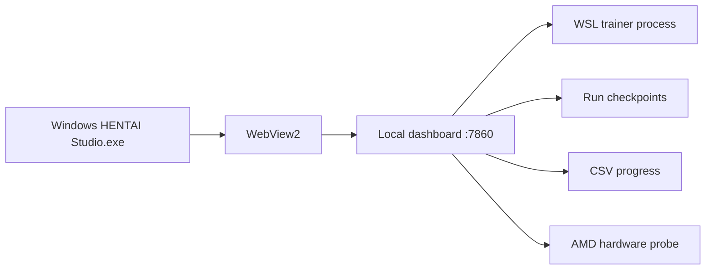

# HENTAI Studio

HENTAI Studio is a native Windows shell around a local WSL dashboard. The interface is rendered through WebView2, while all training state and control logic remain in the Python service at `http://127.0.0.1:7860`.

The current interface has separate **Diffusion** and **LLM** workspaces. Switching tabs does not stop, restart, or reconfigure either trainer.

## LLM workspace

Managed causal-LM runs are discovered beneath `<storage-root>/runs/llm`. The LLM tab provides:

- Run selection and durable state from `run.json`
- Current step, rolling ETA, step time, token throughput, and tokens seen
- Separate training-loss and validation-loss signals
- Complete weights/resume checkpoint inventory
- Process-scoped CPU/RAM and AMD GPU telemetry for the selected run
- CPU-only chat against the newest complete LoRA weights checkpoint

The chat path deliberately unloads its CPU-resident model after a response when GPU training is active, preventing a 4B checkpoint probe from consuming host RAM indefinitely. The API is grouped under `/api/runs` and `/api/diffusion`, with typed contracts and generated docs at `/api/docs`. Chat availability comes from the run capability response.

## Mental model



Closing the app window does not inherently stop training. The trainer and watchdog are WSL processes. Conversely, a visible app does not guarantee the trainer is alive; use the status indicators.

## Progress bars

- **VAE** tracks `vae_max_steps` or shows complete after `models/vae/` exists.
- **Diffuser** tracks `max_steps` after VAE promotion/completion.
- **Overall** adds both configured ceilings. It is a planning measure, not a quality score.

The ETA is based on a rolling median of up to 500 observed step times. Early-run estimates are unstable while kernels warm up and data workers fill queues.

## Learning signal

The chart shows the latest 240 deduplicated loss values parsed from the active training log. Loss should be interpreted as a trend, not a contest for the lowest individual point.

- VAE loss combines reconstruction, KL, and edge terms.
- Diffuser loss is Min-SNR-weighted prediction loss.
- A noisy local curve is normal.
- A falling loss does not by itself prove perceptual improvement.

Use reconstructions and fixed-seed samples alongside loss.

## Trainer controls

### Stop safely

Creates the run's `PAUSED` marker and terminates the trainer. The newest completed checkpoint remains the recovery point. Unsaved work after it will be repeated.

### Resume training

Removes `PAUSED` and starts the architecture-appropriate watchdog if neither trainer nor watchdog is already present.

### Finish VAE at checkpoint & start diffuser

Promotes the newest complete VAE checkpoint to `models/vae/`, records `EARLY_VAE_STOP.json`, calibrates latent scaling, and proceeds to diffusion. The button remains disabled until a complete VAE checkpoint exists.

## VAE reconstructions

While VAE training is active, **Current training run** changes the sample panel into a reconstruction tool.

1. The newest completed VAE checkpoint is loaded on CPU.
2. A random dataset record is selected.
3. The loader performs the same resize/crop behavior as training, with random flipping disabled.
4. The VAE encodes using posterior mode and decodes the latent.
5. The reconstruction is resized to 1080 × 1080 for display.

The output is a reconstruction, not a generated image. It demonstrates what information the VAE preserves. The source record is not copied into the dashboard gallery.

Before the first checkpoint, the button shows the next checkpoint step and estimated wait. It is disabled because there is no saved model to load—not because the interface is stuck.

## Diffuser samples

After the VAE stage, the current-run panel uses the newest completed diffusion checkpoint. Sampling runs on CPU to leave the training GPU undisturbed.

Controls:

- **Tags:** comma-separated conditioning tokens.
- **Seed:** fixes initial latent noise for reproducible comparisons.
- **Steps:** DDIM denoising iterations, clamped to 5–60.
- **Guidance:** classifier-free guidance, clamped to 1–12.

Use the same tags and seed across checkpoints to judge learning. High guidance is not automatically better; it can crush color range, exaggerate artifacts, and reduce diversity.

## Historical checkpoint lab

Select **Historical diffuser checkpoint** to browse complete diffusion checkpoints from any compatible run under `runs/`.

A checkpoint appears only when it has:

- U-Net configuration and safetensors
- Tag encoder safetensors
- Run VAE configuration
- Run vocabulary
- Run configuration

Selections are validated against the catalog and confined to `runs/`; arbitrary filesystem paths are rejected.

## CSV exports

The buttons download the active run's complete append-only logs:

- `HENTAI-Studio-VAE-progress.csv`
- `HENTAI-Studio-Diffuser-progress.csv`

Repeated sessions share the same file but have distinct `session_id` and `resumed_from_step` fields. This makes reboot and recovery boundaries visible in graphs.

## Hardware telemetry

The dashboard samples hardware approximately every three seconds.

| Field | Scope |
|---|---|
| GPU load, VRAM, edge/hotspot, fan, board power | AMD adapter while a trainer owns the compute workload |
| CPU load and RAM | Trainer process tree |
| CPU package power | Windows RAPL counter, proportionally attributed to trainer CPU load |
| Workload power | GPU board power + attributed CPU package power |
| Energy | Time integration of estimated workload power |

These are operational estimates, not billing-grade measurements. CPU temperature is unavailable in the current implementation.

Dashboard telemetry is process-oriented and lives on the same host as the workload. A full system reset can prevent its final samples from being persisted. For hard-reset diagnosis, enable AMD Software performance logging at a one-second interval and preserve the newest file beneath `%LOCALAPPDATA%\AMD\CN\Analytics`. Log at least GPU utilization, edge/hotspot temperature, board power, voltage, core/VRAM clocks, fan speed, and VRAM use. See [Sustained-load stability](https://github.com/Lithium357/HENTAI/blob/main/docs/STABILITY.md).

## Gallery ordering

The dashboard shows the newest 12 PNG samples. On reboot, WSL may briefly inherit a bad clock; files dated more than 60 seconds in the future are moved behind new samples so they cannot permanently dominate the gallery.

## Native Windows app

The app enforces a single instance, waits up to 45 seconds for the local service, and reloads WebView2 after a renderer failure. If a dashboard is already listening on port 7860, it connects to that instance.

Build/install from PowerShell:

```powershell
powershell -ExecutionPolicy Bypass -File \
  \\wsl.localhost\Ubuntu\path\to\HENTAI-Studio\windows\HENTAIStudio\build.ps1
```

The build installs under `%LOCALAPPDATA%\Programs\HENTAI Studio` and creates Start Menu and desktop shortcuts.

### Launcher configuration

Current source defaults to `configs/rx7800xt-scratch-v3-x4-512.json`. Rebuild previously installed binaries that still launch the legacy 256px profile.

Portable overrides are read from the Windows environment:

| Variable | Default |
|---|---|
| `HENTAI_WSL_DISTRO` | `Ubuntu` |
| `HENTAI_WSL_PROJECT` | `/home/masonturlington/HENTAI` |
| `HENTAI_STUDIO_WSL_PROJECT` | `/home/masonturlington/HENTAI-Studio` |
| `HENTAI_CONFIG` | `configs/rx7800xt-scratch-v3-x4-512.json` |

If a dashboard is already listening on port 7860, the app connects to it and does not start another one.

## API summary

The dashboard uses the typed Studio API under `/api`. Open `/api/docs` for interactive documentation, or read the [API reference](API.md). The main resources are run details and checkpoints, configured-diffusion status, historical checkpoint catalogs, samples and sampling status, explicit training commands, and progress downloads.

The API is local and unauthenticated. Do not publish it directly to the internet.
